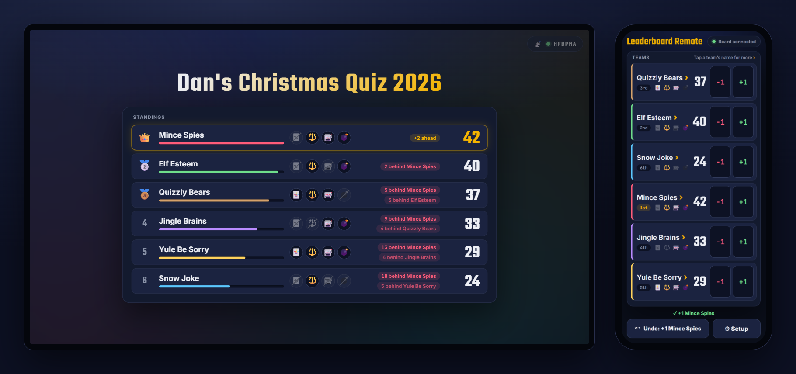

# Dan's Quiz Leaderboard

A live leaderboard for a quiz night: the board goes on the TV, and you run it from your phone.

## Quick start

1. Open the site on the TV. It shows a QR code.
2. Scan the code with your phone.
3. On the phone, tap **⚙ Setup** to add your teams, powerups and title.
4. Tap **+** or **−** on a team to score. Tap a team's name for other amounts and its powerups.
5. **↶ Undo** takes back the last change. The button names it (**Undo: +1 Team Alpha**), and each tap takes back
   one change.

There is nothing to install or build. To try it locally, run `python -m http.server 8000` in this folder and
open <http://localhost:8000/>. To publish it, serve the folder from GitHub Pages or any other static host.

## Usage

For a big finish, tap **Hide scores** in Setup before the last round. When you're ready, tap **Next ▶** once
for each place: the TV reveals them from last place up to the winner, at your pace. **↶ Undo** hides the last
one again. While you reveal, scores are locked and your phone ticks ✓ each team the room has seen.

- Each tap shows on your phone at once, in gold until the TV confirms it. A tap the TV hasn't confirmed is sent
  again, and if the TV made no change, or still hasn't confirmed it after a few seconds, your phone says so.
- Scores are saved on the TV's computer, so reloading the page loses nothing.
- Tap **📡** on the TV to see the QR code again, or to run the remote on the TV's computer.

## Configuration

There is nothing to set when it runs: the defaults (title, teams, powerups and colours) and every limit and
timing are in `js/config.js`.

## How it works

Two pages make up the app: the board (`index.html`) on the TV, and the remote (`remote.html`) on the phone.
It is a static site with no server of its own and no build step, just JavaScript modules, HTML and CSS.

- **The board owns the scores.** The TV saves them in its browser after every change. The phone only sends
  commands, and shows the board as the TV reports it.
- **Phone and TV talk through public MQTT relays.** Several are used at once, so any one being up is enough,
  and a BroadcastChannel links pages open in the same browser. Each command arrives once per relay, so the
  board ignores repeats.
- **Every tap is accounted for.** The TV's status confirms the latest command it handled from each phone, and
  whether that changed anything. Until then the tap shows as pending and is sent again, up to three times
  (the TV still counts it once), and one not confirmed within a few seconds is reported.
- **Undo and Next name what they act on.** The phone sends the label it showed, and the board refuses if that
  is no longer its latest change or its next reveal, so a double tap never undoes or reveals twice.
- **Nothing from a relay is trusted.** Every message is checked and every board cleaned before use, each rule
  checks its arguments again, and text is escaped before it reaches the page.
- **The rules live in one module**, `js/rules.js`, with no page, storage or network, and both pages share it.
  A change returns a new board rather than altering the old one, so Undo is just a stack of earlier boards.
- **Hidden scores give nothing away.** Rows keep their setup order and show "?", places still to be revealed
  are identical empty slots, and no hidden team is ever seen moving.

## Project structure

| File | What it is |
|---|---|
| `index.html`, `remote.html` | The board on the TV, and the phone remote |
| `js/rules.js` | The rules: what a board is, and every change that can be made to it |
| `js/display.js` | The board on the TV |
| `js/remote.js` | The phone remote |
| `js/protocol.js` | What the phone and the TV say to each other in this app |
| `js/relay.js` | The link through the relays and the BroadcastChannel, and the checks on every message |
| `js/display-remote.js` | The TV's side of the link: the pairing dialog, and confirming each phone's taps |
| `js/remote-link.js` | The phone's side of the link: the room code, sending, confirming and sending again |
| `js/one-board.js` | With the board open twice in one browser, which copy takes the phone's taps |
| `js/config.js` | The defaults, and every limit and timing, in one place |
| `js/util.js` | Small helpers, cleaning text, the winner's confetti, and fitting the board to any screen |
| `css/base.css` | The basic styles both pages use, coloured by `css/app.css` |
| `css/app.css` | The Leaderboard's colours and fonts |
| `css/display.css`, `css/remote.css` | One stylesheet for each page |
| `vendor/` | MQTT.js and qrcode-generator, pinned |
| `docs/screenshot.png` | The screenshot in this README |

## Troubleshooting

- **The board is open in two windows.** On one computer (say, a second window to cast to the TV), only one
  takes your phone's taps, and the other says so. **Use this window instead** swaps them. If the one in charge
  is closed or crashes, the other takes over by itself.
- **The TV's screen sleeps, or both copies of the board take taps.** Open it over https (as GitHub Pages does)
  or on localhost. On a plain http address, browsers turn off keeping the screen awake and the check that only
  one copy of the board takes your phone's taps.

## Security

Anyone with the room code can change the scores. **New code** in the 📡 box (tap it twice) makes a fresh one.

## Acknowledgements

Uses [MQTT.js](https://github.com/mqttjs/MQTT.js) and
[qrcode-generator](https://github.com/kazuhikoarase/qrcode-generator) (both MIT licence), and Google Fonts.
